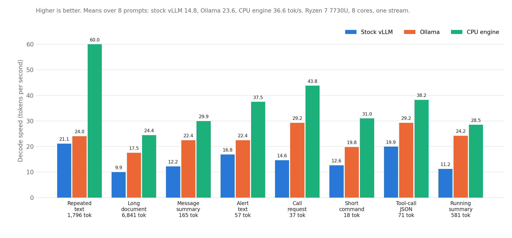
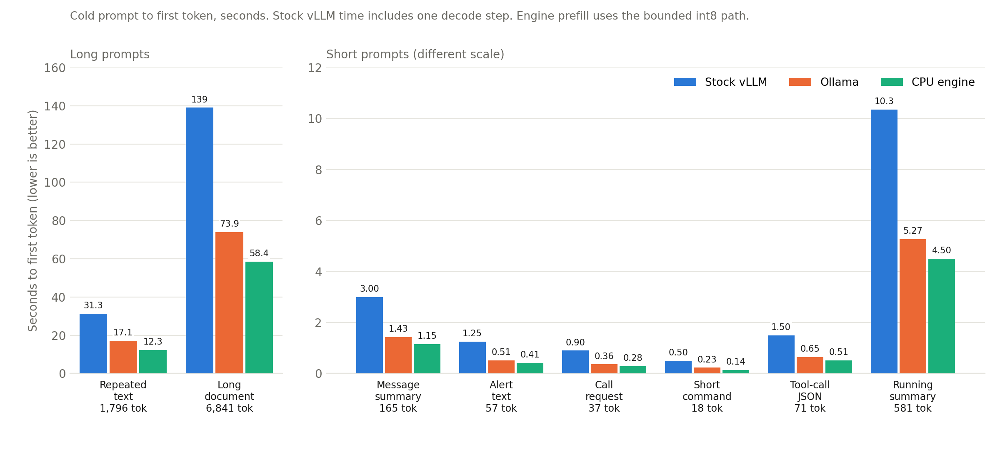

# Gemma-4 E2B on a laptop CPU: my vibe-coding attempt

I wanted a small local language model that answers quickly on an ordinary laptop with **no GPU**: one user, one stream, short prompts, the first token as soon as possible. The obvious tools were Ollama and stock vLLM, so the goal I set was to beat both on the same machine.

**This is a vibe-coding project.** I am not a kernel engineer. I set the goals and the rules, and an AI coding assistant wrote nearly all of the code. The rules I held it to are the interesting part, and they are written up in [docs/METHOD.md](docs/METHOD.md): pose each problem as a math problem, check the claim in Lean when it is arithmetic or logic, measure against a fair baseline in the same session, and write down every experiment that failed. I have not audited every line myself. Treat the numbers as one person's measurements on one laptop.

## What came out

Machine: AMD Ryzen 7 7730U (Zen 3, 8 cores / 16 threads, AVX2 and FMA, no AVX-512), about 15 GB of RAM, no GPU. Model: Google's Gemma-4 E2B, int4 quantisation-aware-trained checkpoint, with Google's MTP drafter for speculative decoding.





| | Ollama (`gemma4:e2b`) | stock vLLM (tuned) | this engine |
|---|---|---|---|
| mean decode speed over 8 prompts | 23.6 tok/s | 14.8 tok/s | **36.6 tok/s** |
| slowest prompt (6,841 tokens) | 17.5 tok/s | 9.9 tok/s | 24.4 tok/s |
| cold prefill of that prompt | 73.9 s | 139.0 s | 58.4 s |

That is 1.55 times Ollama and 2.5 times stock vLLM on average. The advantage is smallest on one prompt (1.18 times Ollama), and the long-prompt case is 1.39 times. Full tables, the exact prompts' lengths and the caveats are in [docs/RESULTS.md](docs/RESULTS.md).

## Why it is faster

Decoding on a CPU is limited by memory bandwidth, not arithmetic. This laptop streams about 21 GB/s, and one pass over the int4 weights is about 1.06 GB, so a forward pass cannot be faster than about 50 ms. The engine gets close to that floor and then reduces how many passes are needed:

- hand-written AVX2 kernels for int4 weights with 32-element scale groups, and an int8 activation path for the rows that benefit
- a **certified head screen**: a small int4 copy of the 262,144-row output matrix finds the candidates, with a proven error bound so the argmax is still exact
- **speculative decoding** with the MTP drafter plus prompt-lookup drafting, so one pass often yields two or three tokens
- a persistent spin-then-sleep thread pool, split-KV attention, adaptive 6-to-8 threads for long prompts
- a prefix cache with several slots, so switching back to an earlier conversation does not re-read the prompt

It also ships an **OpenAI-compatible server** (`/v1/chat/completions`, streaming, `/v1/models`, and a few more) so a client only has to change its base URL.

## Try it

```bash
git clone https://github.com/dayaswaroopchavali/gemma4-e2b-laptop-cpu && cd gemma4-e2b-laptop-cpu
python -m venv .venv && . .venv/bin/activate && pip install transformers fastapi uvicorn openai huggingface_hub
# 1. get the two model folders into models/  (see docs/STEPS.md for the exact names)
# 2. build the engine and the tensor indexes
./build.sh
python tools/make_index.py models/gemma-4-E2B-it-qat/model.safetensors models/engine_index.tsv
python tools/make_index.py models/gemma-4-E2B-it-assistant/model.safetensors models/drafter_index.tsv
# 3. make the example prompts and run the benchmark
python bench/make_prompts.py && python bench/run_engine.py
# 4. or serve it
python server/server.py serve --port 8000 &
python server/test_server.py http://localhost:8000
```

The whole procedure, with what to change for a different CPU, is in [docs/STEPS.md](docs/STEPS.md).

## What is in here

| folder | what |
|---|---|
| `engine/` | the C++ engine (`gemma4_engine.cpp`) and its kernel headers |
| `server/` | the OpenAI-compatible server, its tests and a benchmark |
| `bench/` | benchmark scripts, the prompt generator, comparisons with Ollama and stock vLLM, chart script |
| `proofs/` | the Lean 4 / Mathlib proofs behind the design choices |
| `docs/` | method, step-by-step guide, results, roadmap, the engine's exact layer spec |
| `charts/` | the two charts above |

## Limits, stated plainly

- It is **tuned to one CPU** (Zen 3, AVX2). It will run on other x86 CPUs with AVX2 and FMA, but the thread counts and the speeds will differ, and I have not tried any.
- Decoding is **greedy only**. Sampling parameters are accepted and ignored.
- The int8 decode path is **on by default and slightly lossy**: on my prompts it followed the exact-float output to the end on most prompts and diverged at a near-tie token on the others. `ENGINE_DECODE_INT8=0` turns it off. The measurement is in [docs/RESULTS.md](docs/RESULTS.md).
- The server handles **text only** for now: no audio or image input, no tool-call parsing, no `n > 1`, no `logprobs`. One request runs at a time.
- The numbers were measured on **private prompts** of the lengths listed in the results. The prompts in `bench/` are neutral stand-ins of similar lengths (20 to 6,855 tokens). Speeds depend on the text, because speculative decoding accepts more tokens on repetitive text, so expect similar but not identical numbers.
- This machine's speed drifts by about 10% during a session. Only compare runs from the same session, which is what `bench/ab.py` does.

## Licence

MIT, see [LICENSE](LICENSE). The model weights are not included and are under Google's own Gemma terms.
